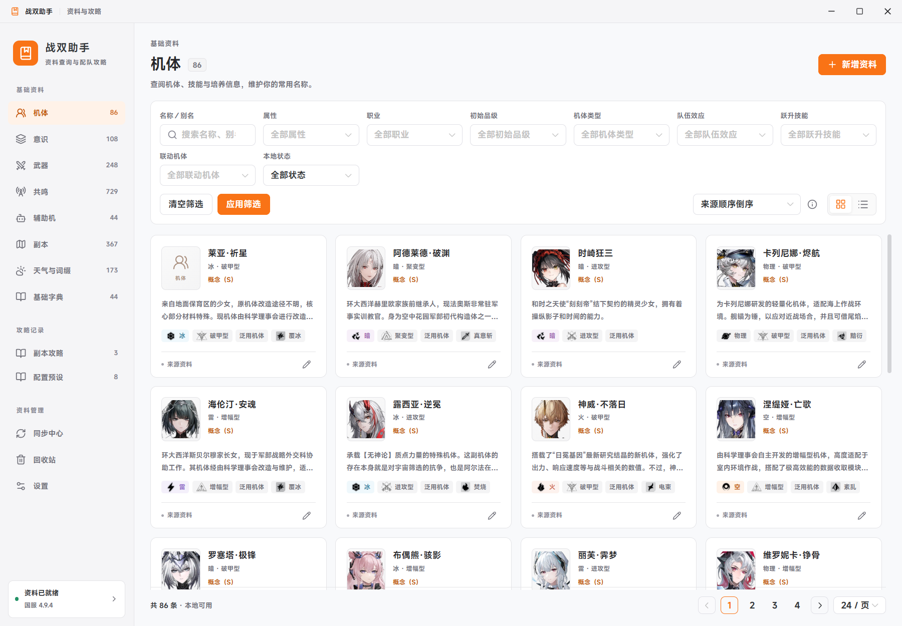
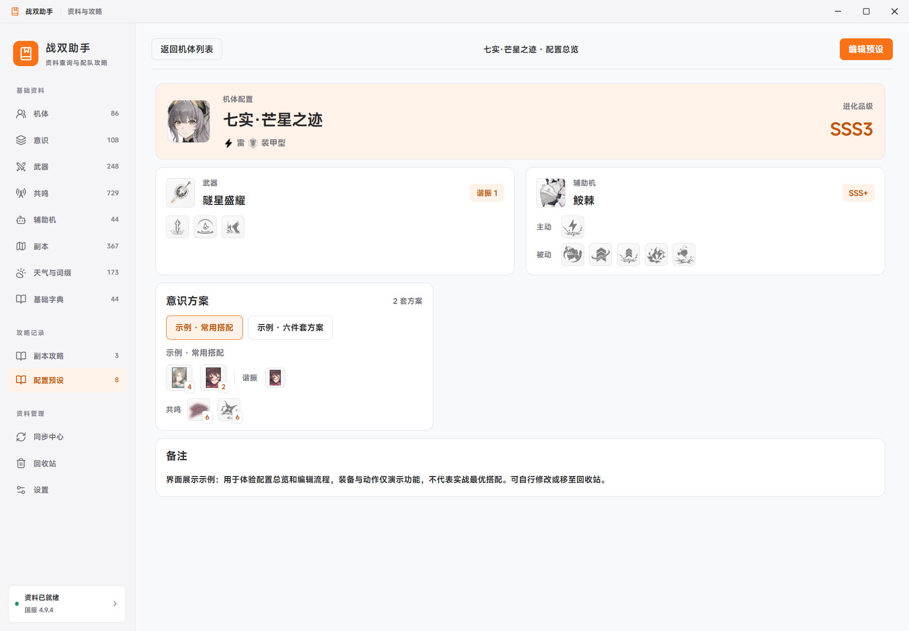
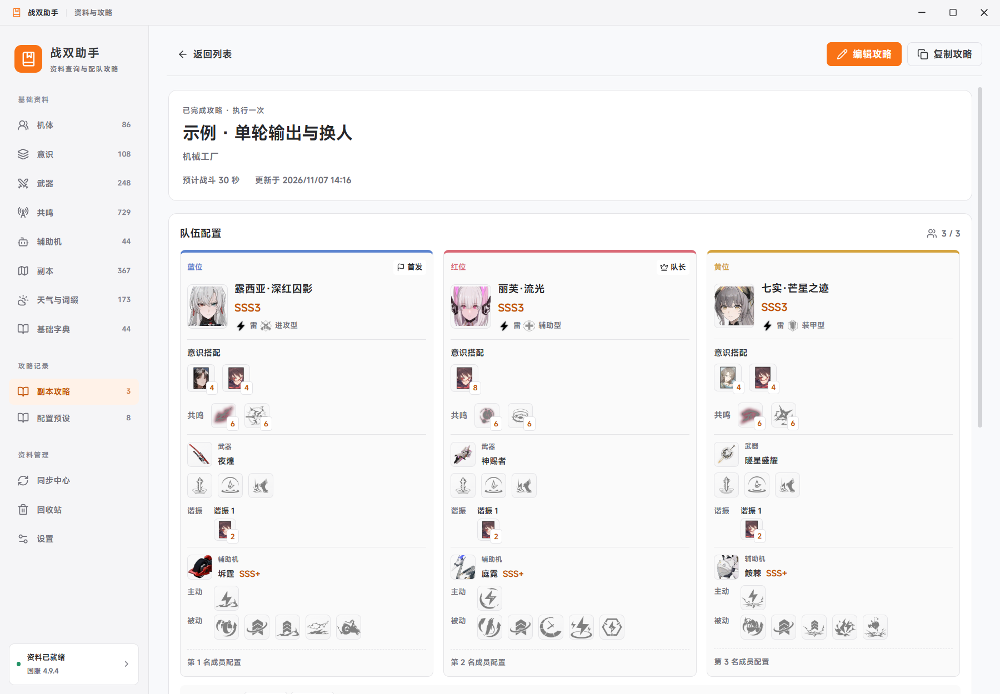
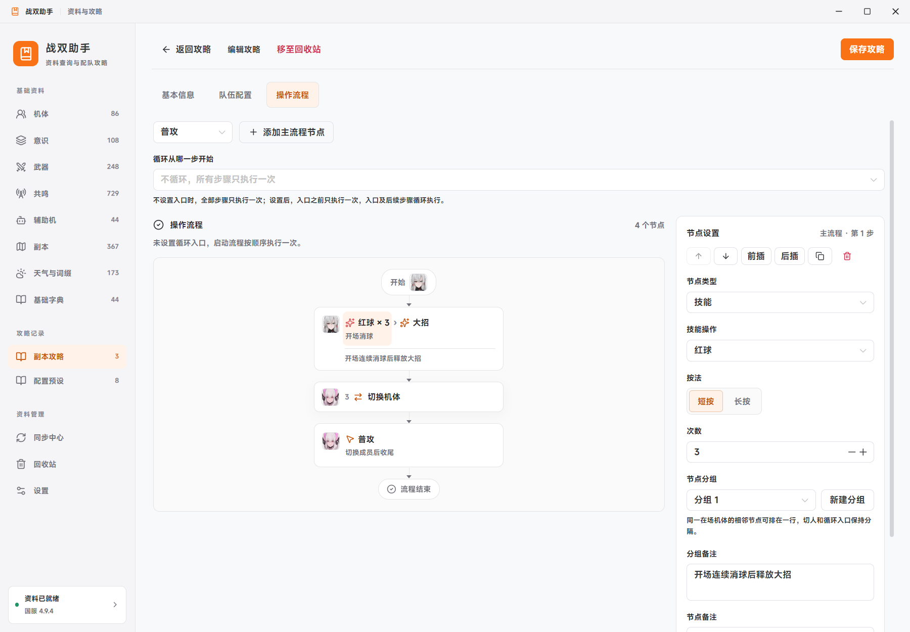

# PGR Helper · 战双助手

English | [简体中文](README.zh-CN.md)

A desktop companion for **Punishing: Gray Raven**: browse reference data, save equipment presets, and record stage guides and action sequences in one place.




## Features

- **Reference catalog** — Characters, memories, weapons, resonances, companions, stages, weather/modifiers, and dictionaries. Search names or aliases, filter by category, and browse grouped skills and related entries.
- **Configuration presets** — Save character progression, weapons, companions, and multiple memory loadouts. Reuse standalone memory and companion presets in guide teams.
- **Stage guides** — Link a guide to multiple stages and record a three-member team, equipment, videos, and notes. Separate overview and editing pages, quick position swaps, duplication, drafts, and a recycle bin.
- **Action flows** — Record switches, orbs, ultimates, attacks, dodges, and ordered QTE calls. Use repetition counts, holds, compact same-character groups, group notes, parallel branches, and an optional loop entry.
- **Local storage** — Manual catalog updates with previews and rollback, local edits, backup/restore, light and dark themes, and installed system fonts.

Equipment, skills, and dictionary options use artwork. Hover or focus overview icons for details. Screenshot configurations demonstrate the interface; they are not gameplay recommendations. The current interface and catalog are in Simplified Chinese.

## Screenshots

### Character presets



### Team overview



### Action flows



## Getting started

Build from source on Windows using the instructions below, then run `release/win-unpacked/战双助手.exe`. Keep the entire application directory in a writable location.

1. On first launch, select **获取基础资料** to fetch the catalog.
2. Review the preview and select **启用这个版本** to activate it. No catalog is bundled, and no local data-repository clone is required.
3. Browse the sidebar categories or open **配置预设** (presets) and **副本攻略** (stage guides).

Initial synchronization needs access to the GitHub API and `raw.githubusercontent.com`. Synced text remains available offline. Images download on demand; only cached images are available offline. Missing images use category placeholders.

Catalog filters require **应用筛选** (Apply); guide and general-preset filters apply immediately. Returning from details preserves the list's filters and scroll position. Long detail and equipment pages provide section navigation.

### Data and backups

- Development uses the project-root `data/` directory. Packaged apps use `data/` beside the executable. Move this directory with the app.
- Export and restore JSON backups in Settings. Restore replaces current content and first saves the previous state under `data/backups/`.
- Backups include catalog versions, local edits, presets, guides, and settings. Downloaded remote-image caches are excluded; retain the entire `data/` directory for a full offline transfer.
- Updates are previewed before activation. Failed or canceled checks leave active data unchanged. The latest five catalog versions can be restored; local edits, presets, and guides are preserved independently.

### Shortcuts

| Shortcut | Action |
| --- | --- |
| `Ctrl+K` | Search catalog |
| `Ctrl+N` | Add catalog entry |
| `Ctrl+Enter` | Save current edit |
| `Ctrl+W` | Close window |

Unsaved edits prompt before leaving. Red/yellow/blue orbs, attacks, and dodges default to one tap; set a count or hold when needed. Without a loop entry, a flow runs once. Steps before a loop entry form its one-time startup sequence.

## Development and builds

Requires **Windows, Node.js 24+, and npm**.

```powershell
npm ci
npm run setup
npm run dev
```

```powershell
npm test
npm run build
npm start
npm run pack
```

Packaging produces `release/win-unpacked/` without personal data. Restart `npm run dev` after changing the main process or preload code.

See [CONTRIBUTING.md](CONTRIBUTING.md) for contribution guidance, source-data tests, and desktop checks. Include reproduction steps, app version, and error messages when reporting a problem. Do not upload personal databases or backups.

## Sources and scope

- Catalog: [myssal/PGR_Data](https://github.com/myssal/PGR_Data). Required CN-server files are fetched remotely and cached by version.
- Artwork: [undertheobservers/PGR_Assets](https://github.com/undertheobservers/PGR_Assets). Images are pinned to a source version and downloaded on demand, without cloning the repository.
- Layout and theme inspiration: [CC Switch](https://github.com/farion1231/cc-switch).

Catalog and artwork updates may lag or contain gaps. Static stage configurations include historical content and are not a live weekly schedule. The app does not read game accounts or live battle state, and does not automate gameplay.

This is an unofficial community project, unaffiliated with the game's publisher. Application code is [MIT licensed](LICENSE). Game names, data, and artwork shown in screenshots belong to their respective rights holders and are not covered by this code license.
