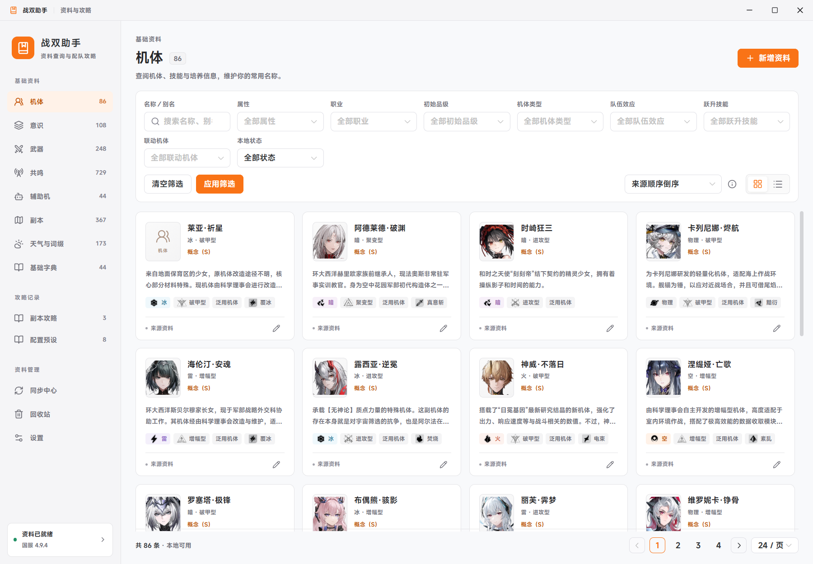
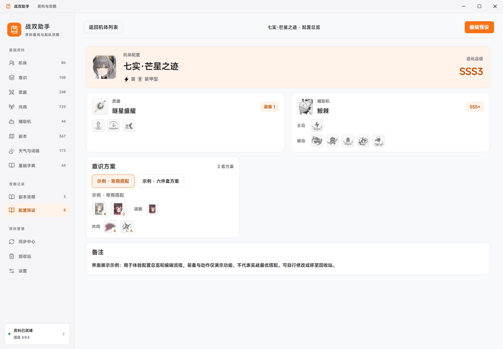
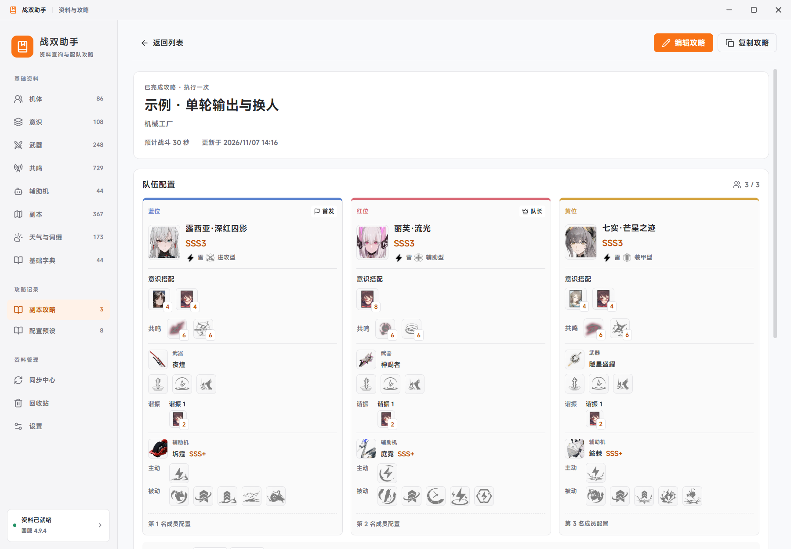
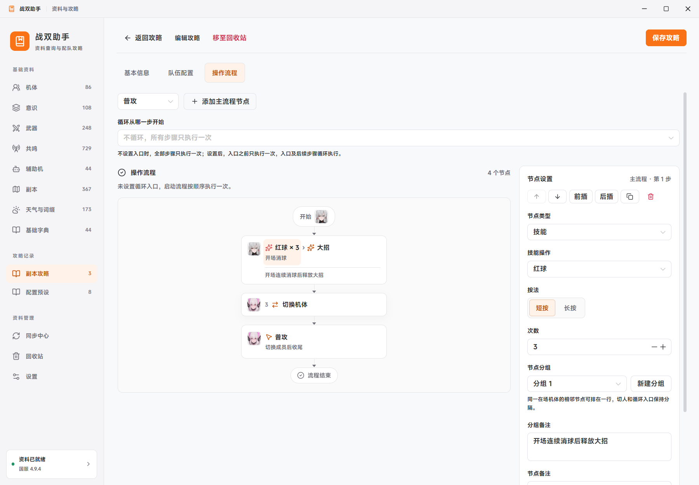

# 战双助手 · PGR Helper

[English](README.md) | 简体中文

战双帕弥什资料查询、配装预设与副本攻略桌面工具。将机体资料、常用搭配和操作流程放在一起，方便查阅、记录和复用。




## 功能

- **基础资料**：查询机体、意识、武器、共鸣、辅助机、副本、天气与词缀、基础字典；支持名称与别名搜索、分类筛选、技能分组和关联资料跳转。
- **配置预设**：每个机体维护培养、武器、辅助机及多套意识方案；通用意识和辅助机预设可单独保存，并引入攻略队伍。
- **副本攻略**：一份攻略关联多个副本，记录三人配队、装备、视频与备注；查看总览与编辑分开，支持快捷换位、复制、草稿和回收站。
- **操作流程**：记录切人、信号球、大招、普攻、闪避与 QTE 顺序；支持次数、长按、同机体紧凑分组、组备注、并行分支和循环入口。
- **本地管理**：手动同步、版本预览与回退、本地资料补录、备份恢复；浅色／深色主题和本机字体可选。

图标用于装备、技能和字典选项；总览中悬停或聚焦图标可查看详情。截图中的搭配与流程用于展示功能，不代表实战推荐。

## 界面预览

### 机体预设



### 副本配队



### 操作流程



## 开始使用

当前提供 Windows 源码构建，步骤见下方。构建完成后，运行 `release/win-unpacked/战双助手.exe`。保留整个应用目录，并将其放在可写位置。

1. 首次启动，在同步页面点击“获取基础资料”。
2. 查看同步预览，点击“启用这个版本”。软件不附带基础资料，也不需要克隆数据仓库。
3. 从侧栏查询资料，或进入“配置预设”“副本攻略”记录自己的搭配与流程。

首次同步需要访问 GitHub API 和 `raw.githubusercontent.com`。文字资料同步完成后可离线查询；图片按需下载，只有缓存过的图片可离线显示。缺图时显示分类占位图。

基础资料筛选需点击“应用筛选”；攻略和通用预设筛选即时生效。资料详情返回列表时保留查询条件和滚动位置。长详情和配装编辑页提供分区跳转。

### 数据与备份

- 开发模式使用项目根目录的 `data/`；成品使用可执行文件旁的 `data/`。移动软件时一并移动数据目录。
- 设置中可导出、恢复 JSON 备份。恢复会替换当前数据，并先将原内容备份到 `data/backups/`。
- 备份包含基础版本、本地修改、预设、攻略和设置；远程图片下载缓存不包含在 JSON 中。完整离线迁移请保留整个 `data/`。
- 同步前先预览，确认后才启用；检查失败或取消不会替换现有资料。最近五份基础版本可回退，本地编辑、预设和攻略独立保留。

### 快捷键

| 快捷键 | 操作 |
| --- | --- |
| `Ctrl+K` | 搜索资料 |
| `Ctrl+N` | 新增资料 |
| `Ctrl+Enter` | 保存当前编辑 |
| `Ctrl+W` | 关闭窗口 |

离开未保存的编辑时会提示确认。攻略中的红／黄／蓝球、普攻和闪避默认一次短按；按需设置次数或长按。不设循环入口时流程执行一次，入口之前的步骤为启动流程。

## 开发与构建

需要 **Windows、Node.js 24+、npm**。

```powershell
npm ci
npm run setup
npm run dev
```

```powershell
npm test
npm run build
npm start
npm run pack
```

`npm run pack` 生成 `release/win-unpacked/`，不包含个人数据。开发时修改主进程或 preload 后需重启 `npm run dev`。

贡献方式、完整源表测试和桌面回归说明见 [CONTRIBUTING.md](CONTRIBUTING.md)。报告问题请附操作步骤、应用版本和错误信息，勿上传个人数据库或备份。

## 数据来源与边界

- 文字资料：[myssal/PGR_Data](https://github.com/myssal/PGR_Data)，读取远程国服所需文件并缓存版本。
- 图片资源：[undertheobservers/PGR_Assets](https://github.com/undertheobservers/PGR_Assets)，按固定图片版本、按需获取，不下载整个仓库。

资料与图片可能存在更新延迟或缺项。静态副本配置包含历史内容，不代表本周开放名单；软件不读取游戏账号或实时战斗状态，也不执行游戏操作。

这是非官方社区工具，与游戏官方无隶属关系。程序代码采用 [MIT 许可](LICENSE)；游戏名称、资料及截图中的美术资源归各自权利人所有，不适用本项目的代码许可。
